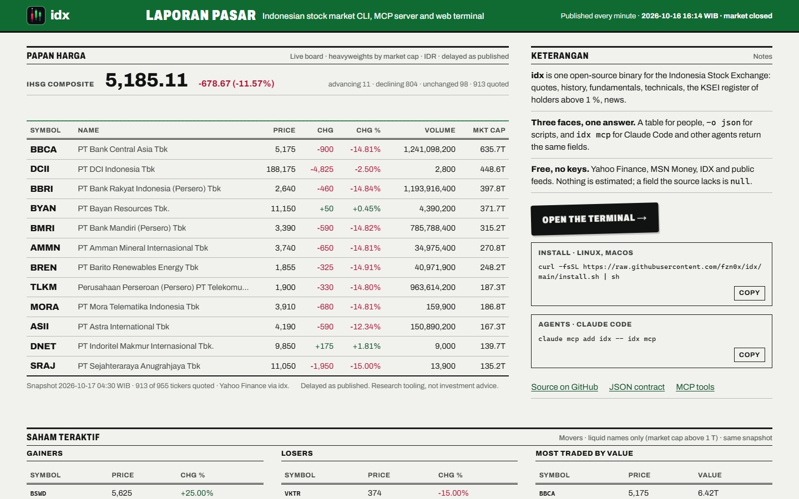
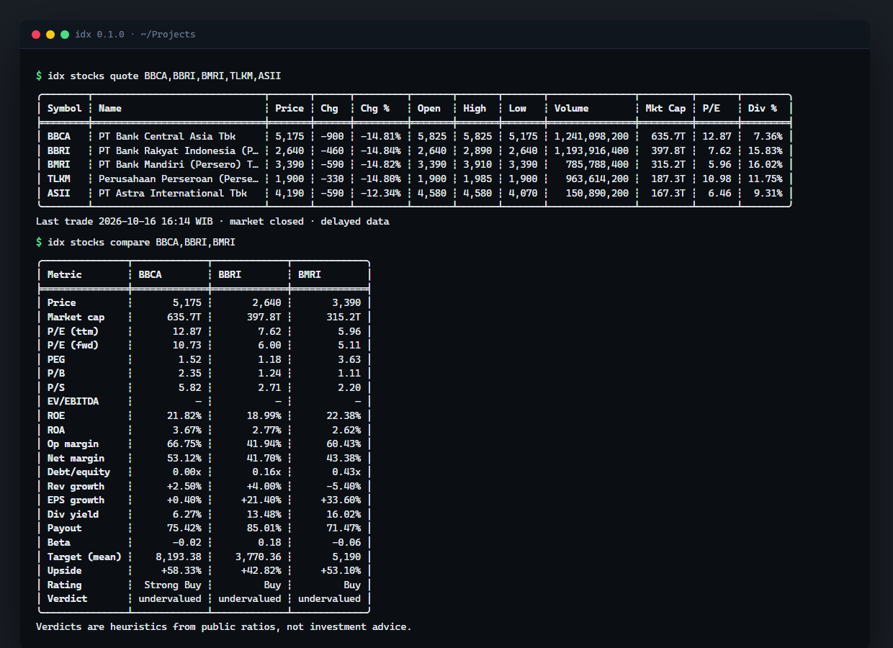
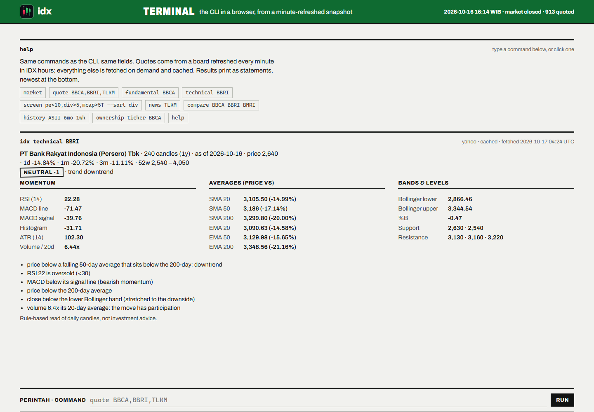

<p align="center">
  
</p>

<p align="center">
  Indonesian stock market (IDX / IHSG) analysis for people and AI agents.<br>
  One binary: a CLI that prints tables, a JSON mode for scripts, and an MCP server for agents.
</p>

<p align="center">
  <a href="https://github.com/fzn0x/idx/actions/workflows/ci.yml"></a>
  <a href="LICENSE"></a>
  <a href="https://ihsg.midoriresearch.com"></a>
</p>

---

<p align="center">
  <a href="https://ihsg.midoriresearch.com"></a>
</p>

```sh
idx stocks quote BBCA,BBRI,TLKM
```

```
╭────────┬──────────────────────────────┬───────┬──────┬─────────┬───────┬───────┬───────┬───────────────┬─────────┬───────┬────────╮
│ Symbol ┆ Name                         ┆ Price ┆ Chg  ┆ Chg %   ┆ Open  ┆ High  ┆ Low   ┆ Volume        ┆ Mkt Cap ┆ P/E   ┆ Div %  │
╞════════╪══════════════════════════════╪═══════╪══════╪═════════╪═══════╪═══════╪═══════╪═══════════════╪═════════╪═══════╪════════╡
│ BBCA   ┆ PT Bank Central Asia Tbk     ┆ 5,175 ┆ -900 ┆ -14.81% ┆ 5,825 ┆ 5,825 ┆ 5,175 ┆ 1,241,098,200 ┆  635.7T ┆ 10.96 ┆  6.27% │
│ BBRI   ┆ PT Bank Rakyat Indonesia (P… ┆ 2,640 ┆ -460 ┆ -14.84% ┆ 2,640 ┆ 2,890 ┆ 2,640 ┆ 1,193,916,400 ┆  397.8T ┆  6.49 ┆ 13.48% │
│ TLKM   ┆ Perusahaan Perseroan (Perse… ┆ 1,900 ┆ -330 ┆ -14.80% ┆ 1,900 ┆ 1,985 ┆ 1,900 ┆   963,614,200 ┆  187.3T ┆ 10.98 ┆ 10.01% │
╰────────┴──────────────────────────────┴───────┴──────┴─────────┴───────┴───────┴───────┴───────────────┴─────────┴───────┴────────╯
Last trade 2026-10-16 16:14 WIB · market closed · delayed data
```

```sh
idx -o json stocks quote BBCA | jq '.data[0] | {price, change_pct, pe_trailing, dividend_yield_pct}'
```

```json
{ "price": 5175.0, "change_pct": -14.814815, "pe_trailing": 10.963983, "dividend_yield_pct": 6.27 }
```

<p align="center">
  
</p>

- **Free data, no keys.** Yahoo Finance and MSN Money for prices and
  fundamentals, IDX's monthly KSEI register for ownership, Kontan and CNBC
  Indonesia feeds for news. Every source sits behind a `Provider` trait, so
  one breaking does not take the tool down, and `auto` fills gaps in one
  source's fundamentals from the other.
- **Built for agents.** `-o json` emits a stable, schema-documented envelope
  (`idx schema quotes`). Exit codes mean something. `idx mcp` exposes every
  command as a typed MCP tool that returns the very same JSON.
- **Works offline.** Responses are cached with per-endpoint TTLs; `--offline`
  serves the cache instead of failing when the network is gone.
- **Ownership, not just prices.** KSEI's monthly register of holders above 1 %
  is imported into local SQLite with normalised entity names, so "who owns
  more than 1 % of BBCA" and "what did this fund change last month" are one
  command each.
- **Single static binary.** Rust, no runtime, Linux / macOS / Windows.

## Install

One line, Linux and macOS (x64 and arm64), verifies the SHA-256 against the
release's `SHA256SUMS`:

```sh
curl -fsSL https://raw.githubusercontent.com/fzn0x/idx/main/install.sh | sh
```

Other ways:

```sh
cargo install --git https://github.com/fzn0x/idx          # from source (Rust 1.88+)
npx @midoriresearch/idx stocks quote BBCA                 # npm wrapper, downloads the matching release
```

Windows: download `idx-<version>-x86_64-pc-windows-msvc.zip` from the
[releases page](https://github.com/fzn0x/idx/releases). Static Linux
binaries are musl builds and run on any distribution.

Shell completions:

```sh
idx completions bash > ~/.local/share/bash-completion/completions/idx
idx completions zsh  > ~/.zfunc/_idx
idx completions fish > ~/.config/fish/completions/idx.fish
idx completions powershell | Out-String | Invoke-Expression
```

## Commands

| command | what it does |
| --- | --- |
| `stocks quote <SYMBOLS>` | Delayed quote for one or many tickers (`BBCA,BBRI` or `BBCA BBRI`; `.JK` optional) |
| `stocks history <SYMBOL> [--period 1y] [--interval 1d] [--limit 30]` | OHLCV candles with a summary line. Periods `1d 5d 1mo 3mo 6mo 1y 2y 5y 10y ytd max`, intervals `5m 15m 30m 1h 1d 1wk 1mo` |
| `stocks profile <SYMBOL>` | Sector, industry, description, size, headquarters, management |
| `stocks financials <SYMBOL> [--period annual\|quarterly\|ttm] [--statement all\|income\|balance\|cash]` | Income statement, balance sheet, cash flow |
| `stocks earnings <SYMBOL>` | Quarterly EPS vs estimates with surprise, yearly revenue/earnings, next earnings date and consensus |
| `stocks fundamental <SYMBOL>` | P/E, P/B, PEG, EV/EBITDA, ROE, ROA, margins, leverage, growth, dividend, analyst targets, plus a plain-language verdict that lists every rule it applied |
| `stocks technical <SYMBOL> [--period 1y]` | RSI, MACD, SMA/EMA 20/50/200, Bollinger, ATR, volume, support/resistance, trend, buy/sell/neutral signal with reasons |
| `stocks compare <SYMBOLS>` | Side-by-side fundamentals for two or more tickers |
| `stocks screen -f "pe<15,roe>15,sector=financial"` | Screener over ~950 IDX tickers: one batch quote for valuation/size/dividend keys, per-company fundamentals for the rest (capped, largest first) |
| `stocks news [SYMBOL] [--source kontan\|cnbcindonesia\|all]` | Headlines from Kontan and CNBC Indonesia RSS, matched by ticker or company name, each with a lexicon sentiment mark |
| `stocks sentiment <SYMBOL>` | Aggregate lexicon sentiment over the matching headlines, with counts, terms and the strongest headlines |
| `ownership import --latest\|--all\|--file F\|--url U` | Import KSEI's monthly ">1 % holders" register (XLSX or PDF) into local SQLite |
| `ownership ticker <SYMBOL> [--as-of D]` | Holders above 1 % of a ticker |
| `ownership entity "<NAME>" [--as-of D]` | Every position of a person or institution, spelling variants grouped |
| `ownership changes --from D --to D [--symbol S] [--min-change PP]` | New holders, exits and position changes between two months |
| `ownership releases\|discover\|path` | Imported months, files published on idx.co.id, database path |
| `mcp` | MCP server over stdio: `idx_quote`, `idx_history`, `idx_profile`, `idx_financials`, `idx_earnings`, `idx_fundamental`, `idx_technical`, `idx_compare`, `idx_screen`, `idx_news`, `idx_sentiment`, `idx_ownership_ticker`, `idx_ownership_entity`, `idx_ownership_changes`, `idx_ownership_releases` |
| `schema [name]` | JSON Schema for every payload (`quotes`, `history`, `profile`, `fundamentals`, `compare`, `financials`, `earnings`, `technical`, `error`, ...) |
| `config init\|set\|get\|path` | Config file management |
| `cache stats\|clear\|path` | Response cache management |
| `completions <shell>` | bash, zsh, fish, powershell, elvish |
| `version` | Version, build and default paths |

Global flags work anywhere on the line:

| flag | env | meaning |
| --- | --- | --- |
| `-o, --output table\|json` | `IDX_OUTPUT` | Output format |
| `--provider auto\|yahoo\|msn` | `IDX_PROVIDER` | Data source (`auto` tries Yahoo, then MSN, and merges fundamentals) |
| `--offline` | `IDX_OFFLINE=1` | Never touch the network |
| `--no-cache` | `IDX_NO_CACHE=1` | Ignore cached responses |
| `--timeout SECS` | `IDX_TIMEOUT_SECS` | Per-request timeout (default 15) |
| `--no-color` | `NO_COLOR` | Plain tables |
| `-v, -vv, -vvv` | `IDX_LOG` | Diagnostics on stderr, including every URL requested |

## For scripts and agents

```sh
idx -o json stocks history TLKM --period 1y --interval 1wk \
  | jq '.data.summary.change_pct'
```

- stdout carries exactly one JSON document; everything else goes to stderr.
- The envelope records `provider`, `fetched_at`, `cached`, `stale` and `warnings`.
- Fields the source did not return are `null`. Nothing is estimated.
- Exit codes: `0` ok · `2` usage · `3` network/provider · `4` not found · `5` offline cache miss · `6` config.

Full field reference: [docs/json-output.md](docs/json-output.md).
Configuration and cache: [docs/configuration.md](docs/configuration.md).

### MCP server

```sh
claude mcp add idx -- idx mcp          # Claude Code
```

Any MCP client that speaks stdio works the same way (`command: idx`,
`args: ["mcp"]`). The server lists eight tools with typed input schemas and
one-paragraph descriptions, and each returns the same envelope as `-o json`,
so an agent that learned the CLI already knows the tools. Failures come back
as tool errors carrying `{error: {code, message}, exit_code}`. Details:
[docs/mcp.md](docs/mcp.md).

## Data sources

| source | used for | auth | notes |
| --- | --- | --- | --- |
| Yahoo Finance `v8/finance/chart` | history, quote fallback | none | IDX tickers carry the `.JK` suffix |
| Yahoo Finance `v7/finance/quote` | quotes | anonymous cookie + crumb, cached 6 h | Falls back to the chart endpoint (fewer fields) if rejected |
| Yahoo Finance `v10/finance/quoteSummary` | profile, fundamentals, earnings | same session | Statement modules are empty at the source, so they are not used |
| Yahoo Finance `fundamentals-timeseries` | financials | none | Annual, quarterly and TTM statement items |
| idx.co.id "Data Kepemilikan Saham" page + `Media/*.xlsx` | ownership (KSEI monthly register) | none, but Cloudflare bot protection | Browser-like request, then `curl-impersonate` if installed, else download in a browser and `--file`. See [docs/ownership.md](docs/ownership.md) |
| Kontan RSS (`investasi`, `keuangan`, `industri`, `insight`) and CNBC Indonesia RSS (`market`, `research`, `news`) | news, sentiment | none | Bisnis.com refuses non-browser clients; listed as an opt-in source |
| MSN Money `Finance/Quotes`, `Finance/Equities` | quotes, profile, fundamentals, analyst targets | MSN's own public web key (shipped; override with `IDX_MSN_API_KEY`) | Tickers resolve to MSN ids through its autosuggest service, filtered to exchange `XIDX` |

Prices are delayed as published by the source. This tool is for research and
tooling; it is not investment advice and not affiliated with IDX, KSEI, Yahoo
or Microsoft.

## Web terminal

**https://ihsg.midoriresearch.com/terminal** runs the same commands in a
browser, no install: `quote BBCA,BBRI`, `fundamental TLKM`,
`screen pe<10,div>5,mcap>5T --sort div`, `news ASII`, `ownership ticker BBCA`.
A Cloudflare Worker refreshes a D1 snapshot of the whole IDX board every
minute in trading hours and serves `/api/*` with the exact JSON envelopes the
CLI prints; everything else is fetched on demand and cached. The Worker lives
in [`web/`](web/) and answers on the custom domain only (`workers_dev = false`,
Host check in the Worker).

<p align="center">
  <a href="https://ihsg.midoriresearch.com/terminal"></a>
</p>

## Development

```sh
cargo build
cargo test                                 # recorded fixtures, no network
cargo clippy --all-targets -- -D warnings
./scripts/smoke.sh                         # live providers
```

Architecture, conventions and "how to add a provider" live in
[AGENTS.md](AGENTS.md). Contributions: [CONTRIBUTING.md](CONTRIBUTING.md).

## License

[MIT](LICENSE)
